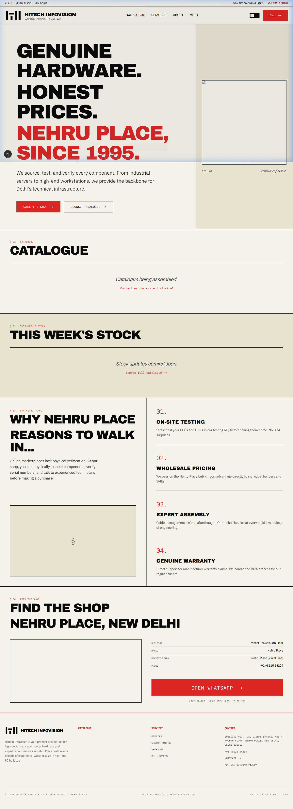
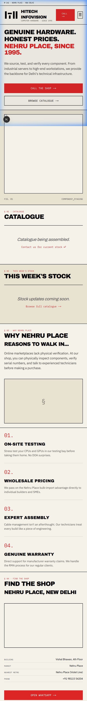
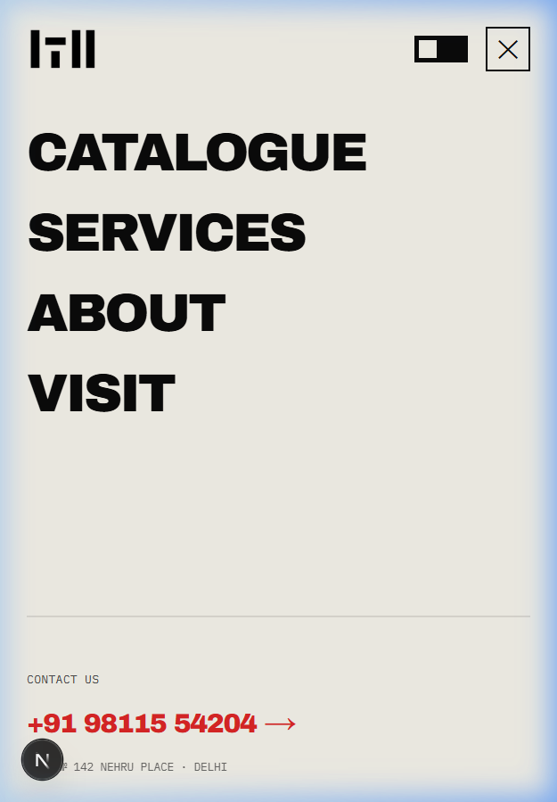
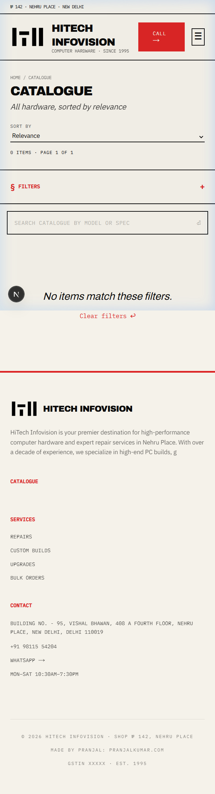

# Hitech Infovision

An e-commerce and business site I built for Hitech Infovision, a computer hardware shop in Nehru Place, New Delhi. It's live.

Live site: [hitechinfovision.com](https://hitechinfovision.com) · Docs repo: [euphoric-habromaniac/hitechinfovision.com](https://github.com/euphoric-habromaniac/hitechinfovision.com)

## What the shop needed

- A site that shows up in search. The old web presence had inconsistent branding, poor search visibility, slow pages and outdated URLs.
- A way for customers to ask about specific, high-value hardware without jumping through hoops.
- A way for the owner to update products, prices and shop details without a developer.

## What I built

- **Storefront.** A product catalogue with search and filtering by category, brand and price. Each product page has an image gallery, a specification table and an availability badge.
- **WhatsApp enquiries.** An "Enquire on WhatsApp" button that pre-fills the product details, and one-tap call buttons on mobile.
- **Admin panel.** The owner manages products, prices, discounts (time-limited percentage offers), services and shop details such as hours, location and contact info.
- **Server-side prices.** The browser never sets a price. The server reads it from the database.
- **Audit log.** Every admin action is recorded in an append-only log.
- **Design.** A custom "Technical Precision Editorial" look: sharp corners, monospace type, no icon libraries, dark mode that follows the system setting.

## SEO work

- Every product and category gets its own generated title, description and canonical tag.
- Structured data (Organization, Product, Breadcrumb) so results can show price, availability and brand.
- Filter links like `?category=x` turned into clean, readable paths, with 301 redirects so old links keep working.
- A sitemap that updates as products are added, and a `robots.txt` that points crawlers at pages worth indexing.
- Social preview images made on demand, so a shared link always shows the current product name and price.
- Server rendering for the main pages, with responsive, prioritised images to keep layout shift and load time down.

## Outcomes

I don't have measured before-and-after numbers to publish, so I haven't put any here. The site is live and the owner runs the catalogue from the admin panel.

## What I learned

- Technical SEO is a feature in its own right. For a shop in a crowded market, search visibility matters as much as clean code.
- Strict validation pays off. Prices are stored in paisa to dodge floating-point errors, and inputs are checked with Zod and TypeScript.
- A tight design system makes you solve problems with type and layout instead of reaching for widgets.
- Deciding what runs on the server and what runs in the browser is the main trade-off in the Next.js App Router.

## Stack

Next.js 16 (App Router), React, TypeScript, Tailwind CSS v4, Supabase (Postgres, Storage), Zod, Vercel.

## Screenshots

  

## License

All rights reserved. See [LICENSE](LICENSE).
